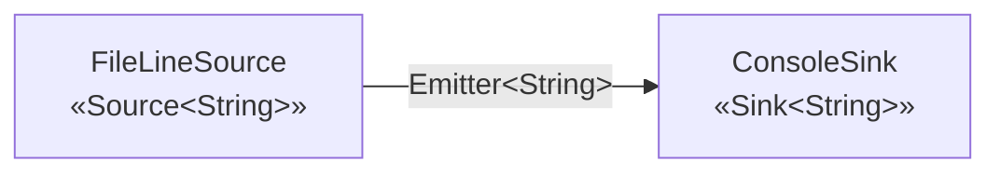
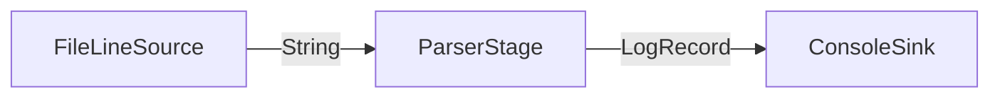
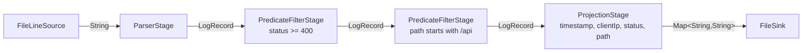
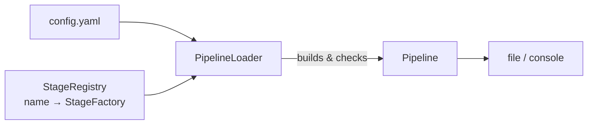

# LogFlow — Architecture (v4)

**Student:** Mohamad Yamen Kabalan — 2404040356

## Architectural style

LogFlow uses the **Pipe-and-Filter** style. Data flows in one direction:
a *Source* produces records, zero or more *Stages* (filters) transform them,
and a *Sink* consumes them. Components never call each other directly —
they only know the **Emitter** (the connector) they push items into.

## Two-box diagram (v1)

```
 ┌──────────────────────┐                     ┌──────────────────────┐
 │    FileLineSource    │      Emitter        │     ConsoleSink      │
 │   «Source<String>»   │ ──────────────────▶ │    «Sink<String>»    │
 │ reads file line by   │   (String lines)    │  prints every line   │
 │ line                 │                     │                      │
 └──────────────────────┘                     └──────────────────────┘
            ▲                                             ▲
            └───────────── assembled and run by ──────────┘
                              Pipeline / Main
```



## Components and connectors

| Element | Kind | Responsibility |
|---|---|---|
| `Source<O>` | component interface | Produces records into an emitter |
| `Stage<I,O>` | component interface | Transforms one input into 0..n outputs |
| `Sink<I>` | component interface | Consumes records at the end of the pipe |
| `Emitter<T>` | **connector** interface | Pushes an item to the next element |
| `Record` | data concept | The unit that flows through the pipe |
| `LogRecord` | domain model | Immutable parsed log entry (v2), implements `Record` |
| `ParserStage` | component (the one stage) | `String` → `LogRecord`; skips and counts malformed lines |
| `Pipeline` | configuration / runner | Holds the ordered stages and wires emitters together |
| `Main` | entry point | Reads args, assembles the pipeline, calls `run()` |

## Interface vs. implementation

The `core` package contains only interfaces. `FileLineSource` and `ConsoleSink`
are *implementations* in the `io` package. `Pipeline` depends only on the
interfaces, so a different source (e.g. network, stdin) or sink (e.g. file,
database) can be plugged in without changing `Pipeline`.

## Why `process` uses an `Emitter` instead of a return value

A stage may produce **zero, one, or many** outputs for one input:

- a filter drops a line → 0 outputs
- a parser converts a line → 1 output
- a splitter breaks a line into fields → many outputs

A return value would force a 1:1 mapping. The emitter removes that restriction.

## How `run()` works

`Pipeline.run()` builds a chain of emitters from the end backwards:
the last emitter calls `sink.consume`, each earlier one calls
`stage.process(item, next)`. The source is then given the first emitter.
Stages are `open()`ed before running and `close()`d afterwards (in reverse order).

## v2 — From strings to a domain model

The pipeline has exactly **one stage** — Source, pump, Sink:

```
FileLineSource ──▶ ParserStage ──▶ ConsoleSink
«Source<String>»  «Stage<String,LogRecord>»  «Sink<LogRecord>»
```



**Separation of concerns.** Reading (`FileLineSource`), understanding (`ParserStage`) and
presenting (`ConsoleSink`) are three different classes. Each can be tested and replaced on its own.

**Inserting a stage in the middle.** `ParserStage` was added between the source and the sink.
`FileLineSource`, `Pipeline` and the `core` interfaces were **not changed** — only `Main`
(assembly) and `ConsoleSink` (it now prints a `LogRecord`).

**`LogRecord` is immutable** — final fields, an unmodifiable copy of the attributes map,
created through a Builder (Java 8 has no `record` type). A record can be shared by any
number of stages without one stage changing what another sees. `toBuilder()` creates a
modified copy.

**The `attributes` map is the extension point.** In weeks 5–7, new stages will attach data
that today's parser knows nothing about (e.g. geo-location, classification, error info).
They put it into `attributes` instead of adding new fields, so the record format is open
for extension without changing `LogRecord` or `ParserStage` (Open/Closed principle).
The parser already uses it for optional data: `protocol`, `query`, `referer`, `ident`, `user`.

**Malformed lines.** In v2 they are only skipped and counted (`ParserStage.malformedCount()`);
`Main` prints the total at the end. Proper error handling is deliberately left for week 5 —
the architecture is built layer by layer.

**Testing without files.** A stage only knows the `Emitter` interface. Tests therefore
create the stage, call `process("…a log line…", collector)` and inspect the
`CollectingEmitter` test double. No file, source, sink or pipeline is needed, which makes
the tests fast, deterministic, and focused on one stage.

## v3 — Composition: filtering, projection and a pipeline builder

```
FileLineSource ─▶ ParserStage ─▶ PredicateFilterStage(s) ─▶ ProjectionStage ─▶ FileSink
 «Source<String>»  «Stage<String,LogRecord>»  «Stage<LogRecord,LogRecord>»  «Stage<LogRecord,Map>»  «Sink<Map>»
```



**One responsibility per stage.** Each new stage does exactly one thing and is small:
`PredicateFilterStage` decides *whether* a record goes on, `ProjectionStage` decides *which
fields* go on, `FileSink` decides *where* they go. Any number of them can be combined in any
(type-correct) order.

**A filter that drops and a stage that transforms are the same architectural element.**
Both implement `Stage<I,O>` and push results through an `Emitter`. A filter emits 0 or 1
outputs per input; a projection emits exactly 1 of a different type. The pipeline does not
know or care which is which — that is why the `Emitter` (not a return value) was chosen in v1.

**`PipelineBuilder` — the assembly mechanism.** `from(source).via(stage)….to(sink)` builds a
`Pipeline`. Its type parameter tracks the type at the current end of the chain, so a wrong
order does not compile: a `LogRecord` filter cannot be placed before the parser
(`String` is not a `LogRecord`), nor after the projection (`Map` is not a `LogRecord`).
`Main` drives the builder from command-line options; in week 4 this becomes configuration —
`Main` stays an assembler and the stages do not change.

**Lifecycle hooks matter now.** `Sink` got `open()`/`close()` (default no-ops, like `Stage`),
and `Pipeline.run()` calls `sink.close()` in a `finally` block. `FileSink` uses a
`BufferedWriter`: lines stay in memory until the buffer is flushed. A sink that never closes
its writer silently loses the end of the output. `FileSinkTest.withoutCloseTheBufferedOutputIsLost`
shows it: after writing a line without `close()`, the file is still **0 bytes**.

**Data minimisation.** `ProjectionStage` keeps only the fields that are asked for. The output
is smaller, and personal data that is not needed (client IP, user agent) does not leave the
pipeline unless it is explicitly requested.

### Ordering experiment (v3)

`src/test/java/logflow/experiment/FilterOrderExperiment.java` — the 200-line sample repeated
5,000 times = **1,000,000 lines**, filters `status >= 400` and `path starts with /api`, projection
to 4 fields. Each configuration runs twice (JIT warm-up) and the second run is reported. Counters
show how many times each stage did work; `hash` is an order-sensitive hash of the whole output.

| Order | Output | status tests | prefix tests | projections | Time (3 runs, ms) |
|---|---|---|---|---|---|
| A: parse → status≥400 → /api → project | 40,000 | 1,000,000 | 285,000 | 40,000 | 1752 / 1982 / 2656 |
| B: parse → /api → status≥400 → project | 40,000 | 200,000 | 1,000,000 | 40,000 | 1924 / 2027 / 2726 |
| C: parse → project → status≥400 → /api | 40,000 | 1,000,000 | 285,000 | **1,000,000** | 2152 / 2300 / 2528 |

All three produced **the same 40,000 records in the same order** (identical hash `796fc579`).
The integration test `filterOrderDoesNotChangeTheResult` checks the same on the fixture.

**Findings**

1. **The filter order does not change the result, only the cost.** The two filters are
   independent conditions joined by AND, so the output is the same. The order decides how much
   work the *second* filter does — it only sees what the first let through (A: 1,285,000 vs
   B: 1,200,000 predicate tests). Rule: put the filter that drops the most records first.
   Here `/api` (20 % pass) is more selective than `status >= 400` (28.5 % pass).
2. **Wall-clock time is dominated by parsing and is noisy.** Parsing 1,000,000 lines costs far
   more than the cheap predicates and the projection, so the time differences between orders are
   about the same size as the run-to-run noise (in the third run C was even the fastest).
   The **work counters are the reliable measure** — they are exact and repeatable. Order
   becomes visible in time when a filter or projection is expensive (a regex, a lookup, a
   remote call).
3. **Filtering before parsing is impossible** — the conditions read `status` and `path`, which
   only exist after the parser. `PipelineBuilder` enforces this at compile time.
4. **Filter before or after projection is a real trade-off.**
   *Filter first* (A, B): projection runs only on the 40,000 survivors, and filters can use any
   field of the full `LogRecord`. *Project first* (C): projection runs on all 1,000,000 records
   (25× more projection work), and the filters must be rewritten for the projected `Map` — they can
   only use fields that survived (filtering on `userAgent` after projecting it away is impossible).
   Projecting early pays off when later stages are expensive, remote or untrusted: they handle
   smaller records and never see the removed fields. LogFlow's default: **filter first, project last**.

## v4 — Configuration-driven composition and a stage registry

The **description** of the architecture (which pipeline to run) is now separated from its
**implementation** (the Java classes). The description is a YAML file; the program only reads it.

```
configs/error-report.yaml ──▶ PipelineLoader ──▶ Pipeline ──▶ run()
                                   │
                                   ▼
                             StageRegistry
                 "parse"   → ParserStage
                 "filter"  → PredicateFilterStage(FieldCondition)
                 "project" → ProjectionStage
```



**Registry / plugin pattern.** `StageRegistry` maps a type name to a `StageFactory`. It is
filled from one registration table (`StageRegistry.standard()`), not from a `switch` in the
loader. Adding a new stage type = writing the stage class + one `register(...)` line; the loader,
the pipeline and the existing stages do not change. Each entry also declares its input and output
type (`parse`: String → LogRecord, `filter`: LogRecord → LogRecord, `project`: LogRecord → Map),
which lets the loader check the stage order.

**Fail fast, fail loudly.** `PipelineLoader` checks everything before it returns a pipeline:
YAML syntax, required sections, unknown source/stage/sink types, missing parameters, parameter
types, unknown parameters (typos), unknown field names, impossible operators, the stage order,
and that the input file exists. Any problem throws `ConfigException`; `Main` prints it and exits
with code 2 — **no log line has been read yet**.

**Configuration-time vs run-time errors.**

| | Configuration-time error | Run-time data error |
|---|---|---|
| Example | `type: filtr`, missing `op`, `value: abc` | a broken line in the log file |
| Where found | `PipelineLoader`, before running | `ParserStage`, while running |
| Reaction | stop immediately with a clear message | skip and count the line, keep going (week 5) |
| Cause | the person who wrote the config | the data |

### Configuration schema (v4)

```yaml
pipeline:
  name: <text>                       # required, shown in the summary line
  source:
    type: file                       # the only source type
    params: { path: <file> }         # required; the file must exist
  stages:                            # required, at least one stage, run in this order
    - type: parse                    # String -> LogRecord, must come before filter/project
      params: { format: clf }        # optional, only "clf" (Common / Combined Log Format)
    - type: filter                   # LogRecord -> LogRecord, keeps records where "field op value"
      params: { field: <field>, op: <op>, value: <value> }
    - type: project                  # LogRecord -> Map, keeps only these fields
      params: { fields: [<field>, ...] }
  sink:
    type: file | console
    params: { path: <file> }         # only for type: file
```

| Item | Allowed values |
|---|---|
| `<field>` | `timestamp`, `clientIp`, `method`, `path`, `status`, `bytes`, `userAgent`, `protocol`, `query`, `referer` |
| `<op>` | `==`, `!=` (text, case-insensitive), `startsWith`, `contains` (text), `>`, `>=`, `<`, `<=` (numbers, only for `status`, `bytes`) |
| `<value>` | a number for `>`, `>=`, `<`, `<=`; any text otherwise |

Several `filter` stages can follow each other (logical AND). The three shipped configs are
`configs/error-report.yaml`, `configs/api-traffic.yaml`, `configs/bandwidth-by-client.yaml`.

**Simplified in v4.** The command-line filter options of v3 (`--min-status`, `--fields`, …,
class `Options`) were replaced by the config file, as planned. The old `ConsoleSink` that only
printed `LogRecord`s was removed; the generic printing sink is now `ConsoleSink`.

## Next increments

The value of the pipeline is not visible yet — this is expected at week one.
Later increments add stages (parsing, filtering, aggregation) **without
changing** the source, sink, or pipeline.
